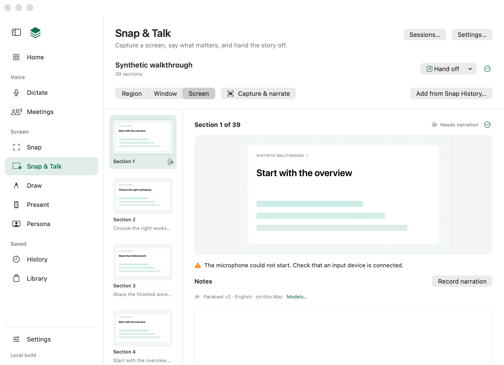
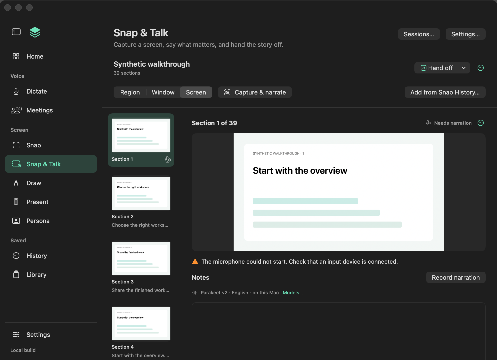
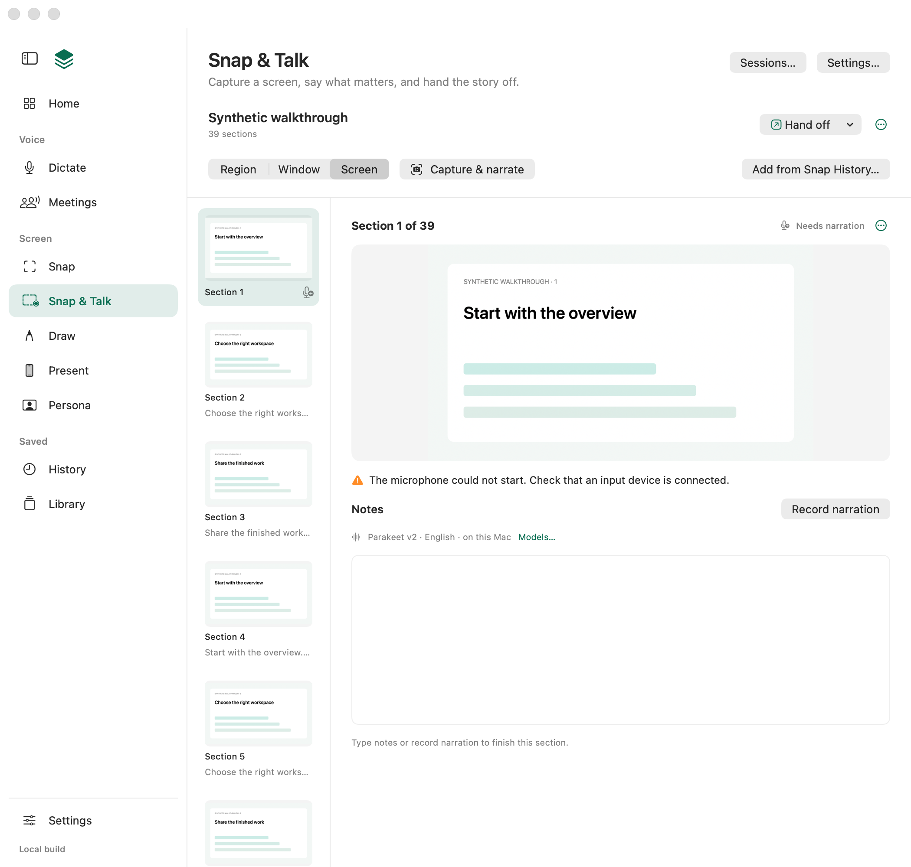
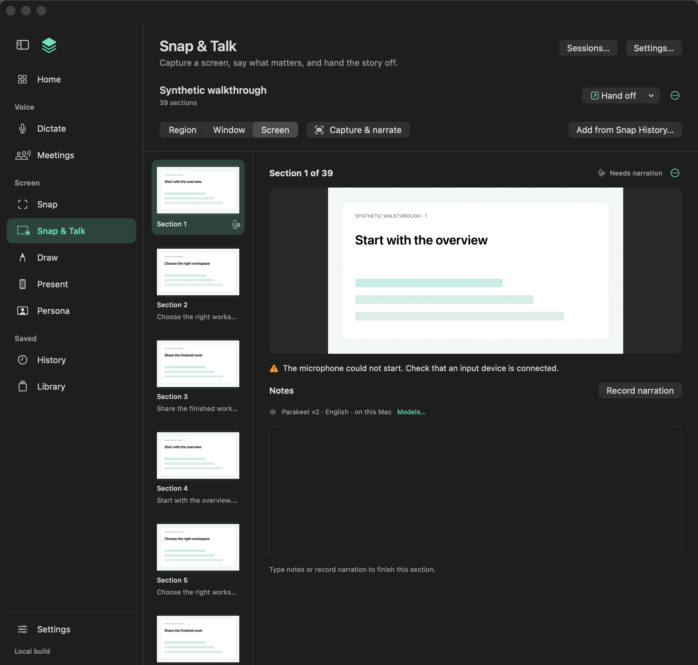

# Snap and Snap & Talk: keep every take, full-resolution screens, one Undo per edit

Source checked **15 October 2026** on branch `claude/snap-takes-and-undo`, based on `main` at `edc15df`. These are source checks and offscreen renders with synthetic data only; native acceptance on the installed Preview is listed at the end and is still owed.

## What changed

1. **Quit keeps a narration in progress** (#330). `ReadbackModel.shutdown()` used to delete the pending take. It now runs Stop's save path without the no-speech cue: the take becomes the section's queued `narration.wav` and the next launch transcribes it. A take shorter than 0.35 s or quieter than -55 dB is discarded exactly as Stop discards it. A small `NarrationRecording` seam lets checks record a synthetic take; the app still builds `AVAudioRecorder` with its delegate and metering as before.
2. **Screen captures keep the display's pixels** (#329). `SnapRendering.capturePixelSize(points:scale:)` multiplies ScreenCaptureKit's point size by the matched screen's backing scale (at least 1, rounded). A Retina MacBook Air's Screen capture is 2940 × 1912 instead of 1470 × 956, matching Region, Window and ⌘⇧3. No cap or setting was added. Larger PNGs reach Claude Code's existing 3.75 MiB per-image and 16 MiB total limits sooner; those limits already explain themselves and Copy instructions still works.
3. **One Undo step per inspector edit** (#331). Typing in Text on image, dragging Text size or Line width, and choosing Background or Colour carry the mark and property they change. A run of them is one Undo step; a selection, another edit, leaving the text box, Undo or Redo starts the next. Undo and Redo keep the mark selected while it still exists. Canvas gestures and nudges are unchanged.
4. **A typed note finishes a section that needs narration** (#63). An audio-less section that needs narration now shows the same Notes editor as a ready one, in one branch so focus survives the change, with "Type notes or record narration to finish this section." A non-empty note makes it ready without inventing audio; whitespace leaves it unfinished, a ready section is never demoted and other statuses are unchanged.
5. **Snap Copy confirms quietly** (#338). Copy on a Snap card or History row shows Image copied beside the controls for four seconds and VoiceOver hears it once, like Save and Export. A failed or unreadable copy keeps its notice with `snap.copy_failed`. Fit rule 7 names a copied Snap.
6. **Replace and Redo use the page's capture area** (#63). Replace screenshot… and Redo screenshot and narration… take the Capture area and own their capture request as Capture & narrate does: Escape changes nothing and starts no microphone, and closing the session or quitting discards a late image. Replace needs only Screen Recording; Redo needs both permissions before a selector opens. If Redo saves the new image and the recorder then cannot start, as with no working input device, the notice now says the screenshot was replaced and its narration kept, instead of claiming the section was not replaced.

## Checks run

All on the debug build of the final source.

| Check | Result | Fails without the change |
| --- | --- | --- |
| `LocalVoice --check-readback` | Passed: 117 store, 25 admission, 12 typed-note, 73 capture-choice, 72 capture-access, 19 availability, 18 recovery, 22 quit, 33 pack and 44 ordering checks | Yes, see below |
| `LocalVoice --check-image-workspace` | Passed: 81 checks | Yes |
| `bash scripts/test-snap.sh` | Passed: 195 Snap checks and 25 refresh checks | Yes |
| `LocalVoice --check-core`, `--check-snap-capture` (182), `--check-capture-preview` (60), `--check-readback-pack`, `--check-read-retirement`, `--check-history-library` | Passed | Regression only |
| `bash scripts/test.sh harnesses` (surface registry 682 entries, Python harnesses, extension tests) | Passed; no settings suites left behind | Regression only |
| `LocalVoice --render-surfaces` (full gallery) | 350 renders, 0 flags | Visual |
| `LocalVoice --render-surfaces` with the desktop pass, which holds the Snap & Talk session states | 186 renders, 0 flags | Visual |

Each new check was confirmed to fail on main's behaviour by reverting only the production change, rebuilding and running it:

- Quit: `shutdown()` calling `cancelNarration()` again fails "quitting keeps the take as the section's queued narration".
- Retina: the helper returning the point size fails "a Retina screen captures at its full pixel size".
- Undo: `change()` pushing every edit fails "150 keystrokes in a caption are one Undo step"; Undo clearing the selection fails "Undo restores the caption before typing and keeps its mark selected".
- Typed note: removing the status change fails "a typed note makes the section ready with no invented audio or original transcript".
- Copy: main's `copy(_:)` fails "a copy is confirmed as Image copied, with no lingering notice".
- Replace and Redo: always capturing the screen fails "Replace uses the chosen region's selector and archives the earlier screenshot"; removing Redo's permission check fails "Redo without the microphone explains before opening a selector it could not narrate"; Redo's old "The section was not replaced" notice after the image was saved fails "Redo whose recorder cannot start says the screenshot was replaced, not that nothing changed".

The Redo admission checks now give their model fixed permissions and a recorder that refuses to start, so they no longer depend on this Mac's privacy settings; their assertions are unchanged.

## Renders

The new `needs-narration` gallery state is a capture whose microphone could not start. The before image is main's view drawn in that same state; the after image is this branch.

| | Light | Dark |
| --- | --- | --- |
| Before |  |  |
| After |  |  |

Before, the section offers only Record narration. After, the Notes editor sits under Record narration and the failure note.

The gallery's window ends inside the editor, so the new caption is out of its frame. To check the caption's wrapping and contrast, the same state was also drawn once in a taller 1050 × 1000 window, using a temporary gallery change that is not committed:

| Light | Dark |
| --- | --- |
|  |  |

"Type notes or record narration to finish this section." sits on one line under the editor, in the same secondary caption style as "Optional notes save automatically."

Against main's full gallery, 316 of 350 renders are byte-identical, including the Snap page, its compact and editor states, and the Snap & Talk page: the confirmation's reserved width is unchanged because Image copied is shorter than Saved to History. The other 34 differ only in render-time timestamps, generated report identifiers and the History from-Home scroll and thumbnail timing, none of which this branch touches.

## Known limit

A section that needs narration but already has non-empty notes on disk stays unfinished until the notes are edited. That happens when a noted, audio-less section's Record narration is interrupted by a crash or force quit (recovery marks it Recording was interrupted) or its narration save fails. The page shows the notes, the interruption note and "Type notes or record narration to finish this section.", and one edit finishes it. Finishing it automatically would mean recovery reading note files and hiding the interruption note, a change to recovery and `markNeedsNarration` that this branch does not make.

## Not verified natively

- ⌘Q while narrating with a real microphone on the signed Preview, including `AVAudioRecorder` finishing the file at logout.
- The Snap editor footer showing 2940 × 1912 px for a Screen capture on a Retina display.
- Replace and Redo through the real Region and Window selectors, including Escape and the window hiding and returning.
- Redo's notice on a Mac whose microphone is allowed but has no working input device.
- Typing a caption and dragging sliders by hand, and which control receives ⌘Z while the text box has focus.
- VoiceOver hearing Image copied once.
