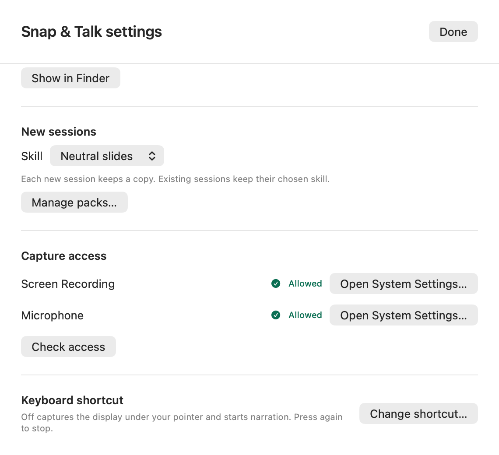
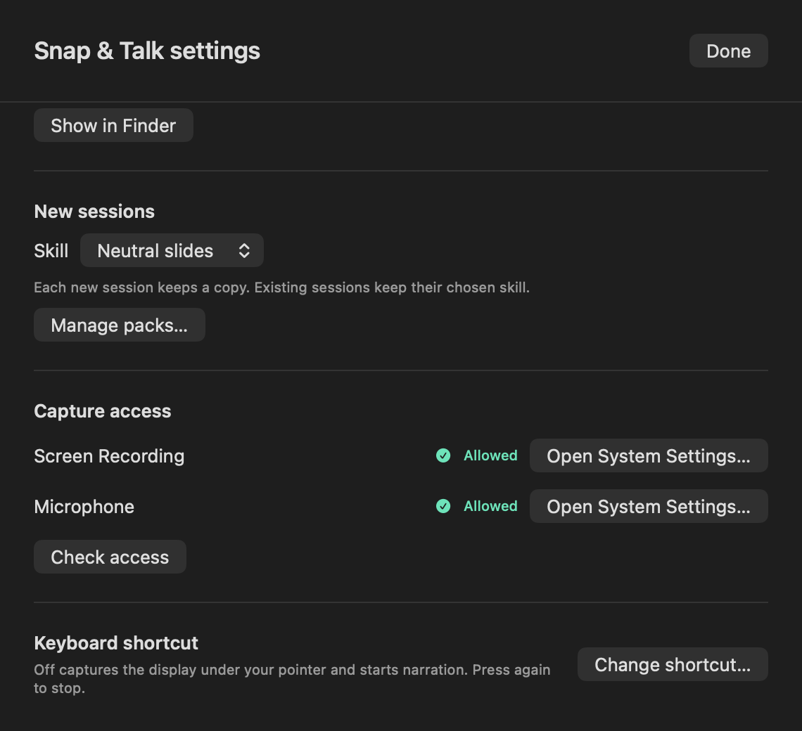
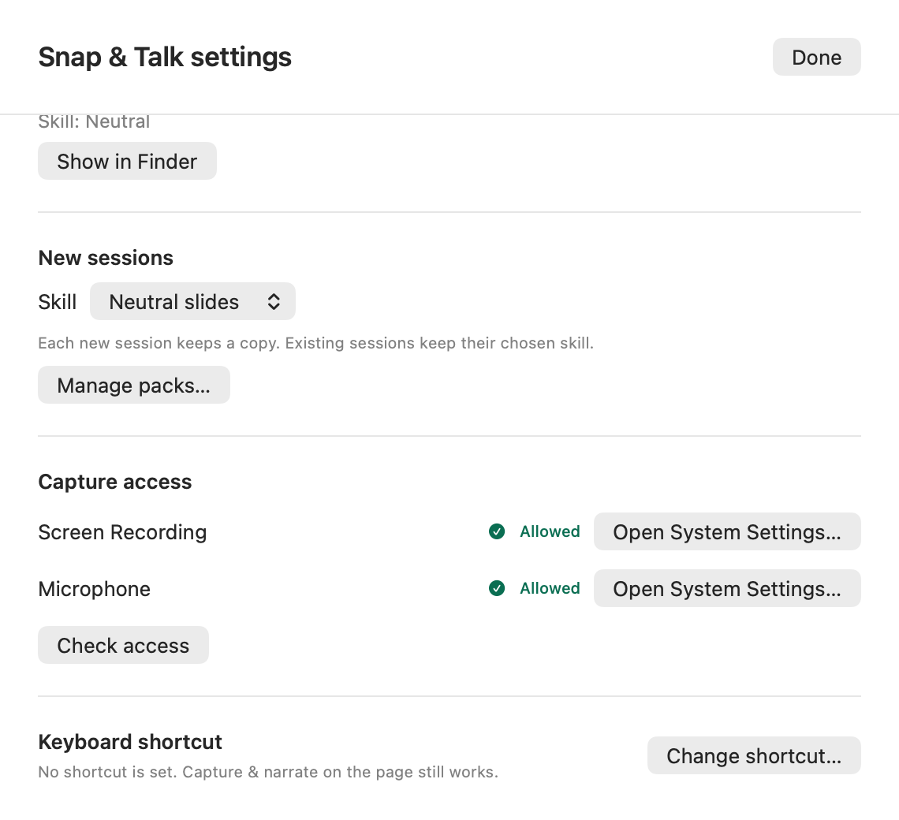
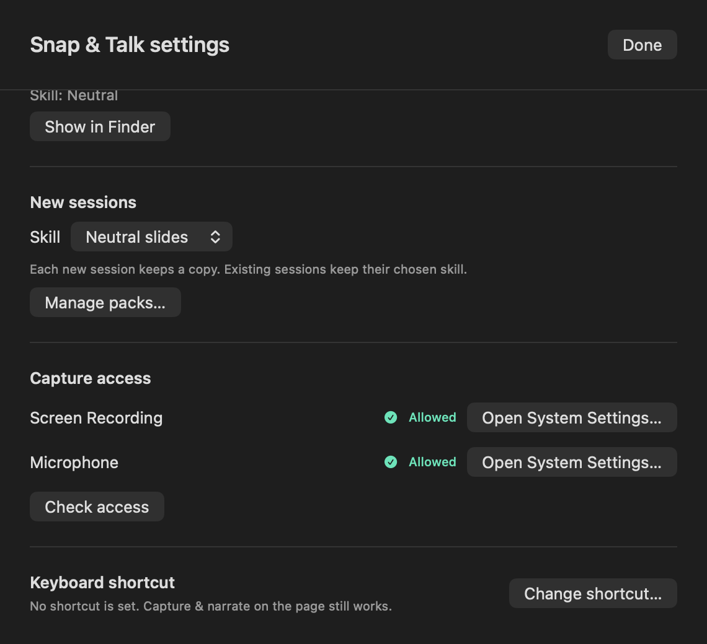

# Snap & Talk: a silent retake keeps the earlier words, the toolbar's Cancel asks first, the notice names a working key

Source checked **15 October 2026** on branch `claude/snaptalk-retake-and-cancel`, stacked on the 15 October release train `claude/train-1015` (main `edc15df` plus that night's nine PRs). Refs #342. These are source checks and offscreen renders with synthetic data only. Native acceptance on the installed Preview is listed at the end and is still owed.

## What changed

1. **A retake that hears no words keeps the earlier words.** Stop now sets aside only the earlier audio and its original transcript. The notes or edited narration (`narration.txt`) stay linked, and stay in the page, while the new take transcribes. When the take has words, the still-linked text moves to `history/` before the new files are written. When it has none, the silent WAV moves to `history/` and the section's audio is cleared. A section that still has text stays Ready with no failure. A section with nothing linked goes back to Needs narration with "No speech was heard. Record the narration again." The notice reads "No speech heard. The screenshot and any earlier narration were kept." So the page no longer shows Transcription stopped, Retry transcription or "1 needs a retry" for a take that can only fail again. Real engine failures keep `.failed` and Retry transcription, as before, and the earlier text stays on disk. `docs/snap.md` has one new sentence.
2. **The toolbar's Cancel narration asks first, as the page does.** ReadbackModel now holds one rule for both doors: `cancelAsksFirst(elapsed:)` (more than ten seconds), `requestCancelNarration()`, the published `pendingCancelNarration` (the take's identity) and `confirmCancelNarration(_:)`, which acts only on the take it asked about. The page's existing "Discard this narration?" dialog binds to that question. The toolbar chooser's Cancel narration discards a short take at once, as before. For a longer take it opens Snap & Talk with the page's question showing, so it no longer deletes up to five minutes without asking. The question clears whenever recording ends, including the 300 s auto-stop. There is no alert, so the narration timer keeps running. `docs/floating-toolbar.md` says so in one clause.
3. **The narration notice names its key only when the key works.** `usableShortcutLabel` reads the model's own preferences and is nil when the Snap & Talk shortcut is off or failed to register. Without a usable key, the notice ends "Use Stop narration to finish." instead of "Use Off again to stop.", and the Capture & narrate help leaves out the key. The options sheet shows the registration failure, or "No shortcut is set. Capture & narrate on the page still works." With a working key, every sentence reads as before.

No control, label, setting or entry point was added. `python3 scripts/check-surfaces.py` reports the registry unchanged.

## Checks run

All checks ran on the debug build of the final source.

| Check | Result | Fails without the change |
| --- | --- | --- |
| `LocalVoice --check-readback` | Passed: 117 store, 25 admission, 12 typed-note, 73 capture-choice, 72 capture-access, 19 availability, 18 recovery, 28 quit, **29 retake**, **16 cancel**, **9 shortcut-notice**, 33 pack and 44 ordering checks | Yes, see below |
| `swift test --filter ToolbarActivityChooserTests` | Passed: 7 tests | Regression only |
| `LocalVoice --check-core`, `--check-capture-preview` (60), `--check-readback-pack`, `--check-snap-capture` (182) | Passed | Regression only |
| `bash scripts/test-snap.sh` | Passed: 195 Snap checks and 25 refresh checks | Regression only |
| `bash scripts/test.sh harnesses` | Passed | Regression only |
| `LocalVoice --render-surfaces` with `WORKBENCH_SNAPTALK_GALLERY_ONLY=1` | 12 renders. Only the new options-with-shortcut-off pair differs from the train's | Visual |
| `LocalVoice --render-surfaces` with the desktop pass, which holds the Snap & Talk session states | 194 renders, 0 flags. The new state's pair is byte-identical to the after images below | Visual |

Each new check was confirmed to fail without its change:

- **Retake.** The new checks were run against the train's `ReadbackModel.swift`, with only the checks added. They fail "notes: Stop keeps the earlier text linked and in the page's draft while the take transcribes". With Stop's change kept but the no-words branch replaced by the old throw, they fail "notes: an empty result leaves the section ready with no audio to retry". The checks stop at the first failure, so the narrated, fresh and nothing-linked cases were not run separately under that mutation. They assert the same branch.
- **Cancel.** `requestCancelNarration()` discarding at once, as the toolbar door did, fails "at 74 s Cancel asks about this take and keeps the file". Removing the clear when recording ends fails "Stop clears the question".
- **Shortcut notice.** Returning the label unconditionally fails "a disabled shortcut has no usable label". Dropping only the registration guard fails "a shortcut that failed to register has no usable label".

The retake checks use the synthetic recorder from #330 and a controlled transcriber. The cases cover imported notes, an earlier narration, a fresh capture's empty note, nothing linked, an engine failure and words. The cancel checks move the synthetic take's meter to 74 s, 5 s and 300 s, so they need no microphone.

## Renders

The new `settings-shortcut-off` gallery state opens Snap & Talk's options with the shortcut turned off. The before images were drawn from the train's view in the same state. On the train, the options read a different preferences store from the model's, so for the before image only, the state also wrote the same preference there. That temporary line is not committed.

| | Light | Dark |
| --- | --- | --- |
| Before |  |  |
| After |  |  |

Before, the Keyboard shortcut line says "Off captures the display under your pointer and starts narration." After, it says "No shortcut is set. Capture & narrate on the page still works." In the same gallery, the review, access-off, access-pending and default options renders are byte-identical to the train's.

Item 1 changes no view code. A section that comes back from an empty retake is drawn by the existing Ready branch with its notes, as the gallery's review state already shows. The dialog in item 2 is a native confirmation that the offscreen gallery does not draw.

## Not verified natively

These need the installed Preview, a microphone and a person:

- Re-record over a section with notes while the input is muted. The notes should stay, and no Retry should appear.
- Narrate past 10 s, then choose Cancel narration in the toolbar chooser. Snap & Talk should open with "Discard this narration?" showing, and Keep recording should continue the take. Whether the dialog appears when the page mounts with the question already set can only be seen natively.
- With ⌥C off, choose Capture & narrate. The notice should end "Use Stop narration to finish."

The chooser's Cancel narration line is covered only through the model rule it calls. No automated check drives the chooser command itself.
